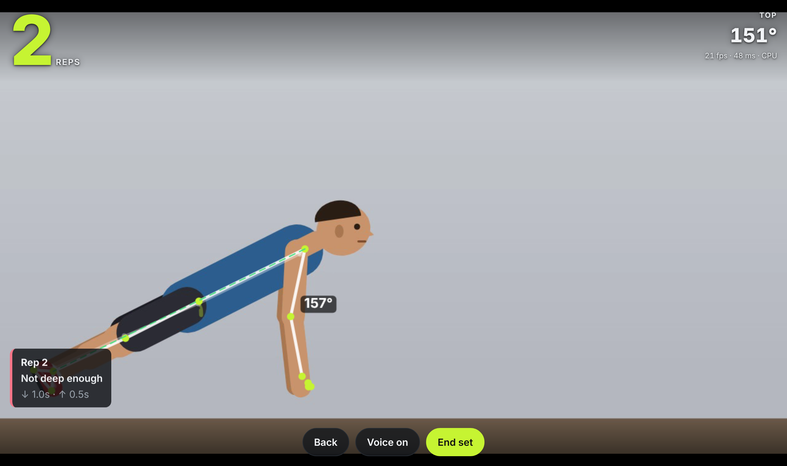
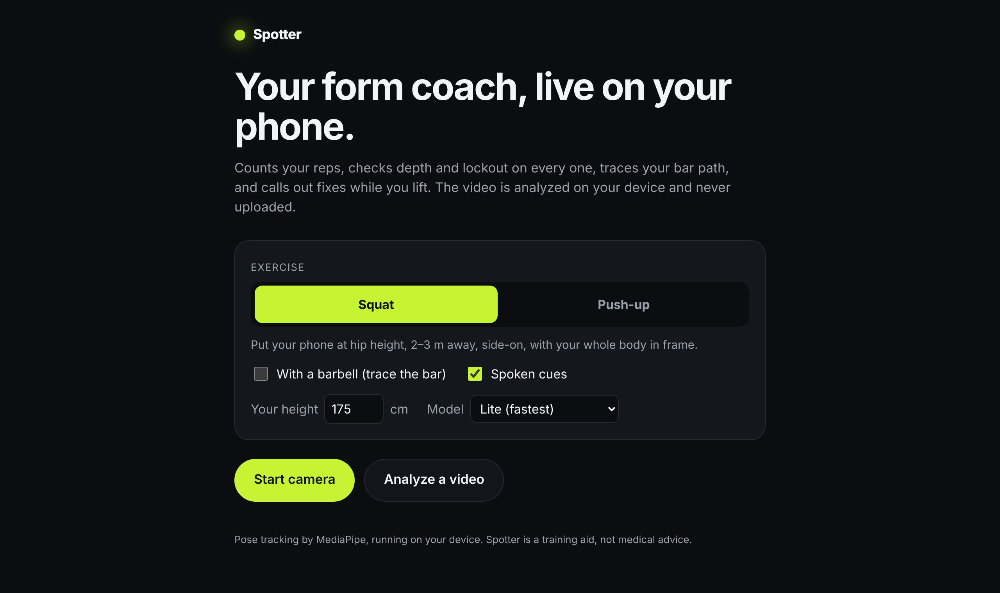

# Spotter — a real-time form coach that runs on your phone

Prop your phone up side-on, lift, and Spotter:

- 🔢 **counts your reps** live and times each one (seconds down / seconds up)
- ✅ **checks every rep**: squat depth (hip below knee), lockout and torso lean; push-up depth and hips sagging or piking
- 📈 **traces your bar path** (or hip path) over the video
- 🔊 **calls out a fix** the moment a rep finishes ("Deeper", "Squeeze your glutes"), or just says the count when the rep is clean
- 📝 **sums up the set**: which reps were flagged, the shallowest rep against your typical one, and whether you slowed down

Pose tracking runs **in the browser on your device** (MediaPipe on the GPU, ~30 FPS on a recent phone). The video is never uploaded.

<p align="center">
  
</p>

<p align="center">
  
  
</p>

> The screenshots use a **drawn test mannequin**, not a real person: it is how CI tests the full pipeline without footage of anyone (see [Testing](#testing)).

## How it works

```
camera frame ─► MediaPipe Pose Landmarker (GPU, WASM) ─► One Euro smoothing ─► joint angles, hip vs knee
                                                                                    │
                         rep state machine: waiting → top → down → up → top ◄───────┘
                                    │ on each finished rep
                   depth / lockout / lean / hip checks · tempo · path drift
                                    │
                 overlay + spoken cue (same frame) ─► set summary when you stop
```

- **Pose:** [MediaPipe Pose Landmarker](https://ai.google.dev/edge/mediapipe/solutions/vision/pose_landmarker) (BlazePose, 33 landmarks), Lite or Full model, GPU delegate with a CPU fallback. The WASM runtime and models are served by the app itself and cached for offline use (PWA).
- **Smoothing:** a [One Euro filter](https://gery.casiez.net/1euro/) per coordinate: steady when you are still, little lag when you move.
- **Side choice:** uses the side of the body facing the camera, by landmark visibility, and only switches when the other side is clearly better.
- **Rep counting:** a state machine on the main joint angle (knee for squats, elbow for push-ups) with hysteresis, so small dips and bounces at the bottom are not counted as reps.
- **Form checks** (`web/src/core/exercises.ts`):
  - Squat depth: hip lower than the knee at the deepest point, measured relative to thigh length.
  - Lockout: the joint gets back to near-straight before the next rep, so this flag lands when the next rep starts.
  - Squat torso lean: more than 60° from vertical.
  - Push-ups: elbow angle at the bottom, and the hip's distance above or below the shoulder-to-ankle line.
- **Centimetres:** estimated from your height and your measured leg length (thigh + shin ≈ 49% of height).
- **Voice:** the browser's built-in speech, so cues have no network delay.

All of the analysis lives in `web/src/core/`: plain TypeScript with no browser APIs, so the exact same code runs live, in unit tests and in evaluation scripts.

## Run it

```bash
cd web
npm install
npm run dev        # downloads the pose models once, then serves on http://localhost:5173
```

On a phone, open the dev server's network URL over HTTPS (browsers only allow the camera on HTTPS or localhost), or deploy it.
**Deploy:** import the repo into Vercel; `vercel.json` builds the `web/` app.

## Testing

```bash
cd web
npm test           # unit tests: analyzer, geometry, filter (synthetic poses with known answers)
npm run e2e        # Playwright: the real app + real MediaPipe model in headless Chromium
```

- **Unit tests** feed the analyzer synthetic side-view skeletons where the true answer is known:
  - exact rep counts, shallow reps, missed lockouts and tempo;
  - small dips that must not count;
  - 15 FPS input;
  - noisy landmarks with 5% of frames dropped.
- **End-to-end tests** run the full pipeline (video → MediaPipe → analyzer → UI) on a drawn mannequin doing 3 push-ups:
  - once as an uploaded video;
  - once through Chromium's fake camera.

  Both must count 3 reps. `scripts/make-mannequin-video.mjs` renders the clip.

**What the mannequin does not prove:** accuracy on real people. MediaPipe tracks the drawn figure's arms well, but its elbow angles are about 20° off, and its legs in a deep squat are unreliable. Accuracy will be measured on labelled real footage (next milestone).

## Status and roadmap

- [x] **1. Core:** camera and video input, pose tracking, smoothing, rep counting and form checks for squats and push-ups, voice cues, set summary, PWA, unit and end-to-end tests
- [ ] **2. Real-footage eval:** labelled side-view clips; rep-count accuracy, depth precision and recall, per-frame latency on phones
- [ ] **3. Learned fault model:** a small temporal model (PyTorch → ONNX Runtime Web) over each rep's landmarks, kept only if it beats the rules above
- [ ] **4. Bar tracking:** a small detector for the barbell plate, replacing the wrist-based bar path
- [ ] **5. Set summary in words:** the per-rep numbers (never video) sent to an LLM for a short coaching note; history across sessions

Spotter is a training aid, not medical advice.
