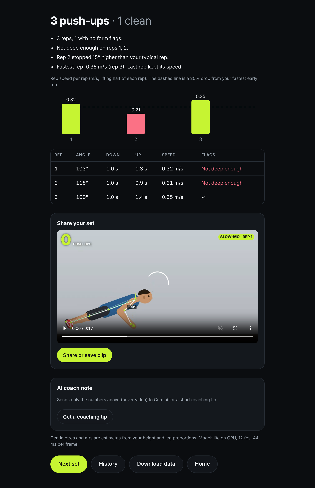
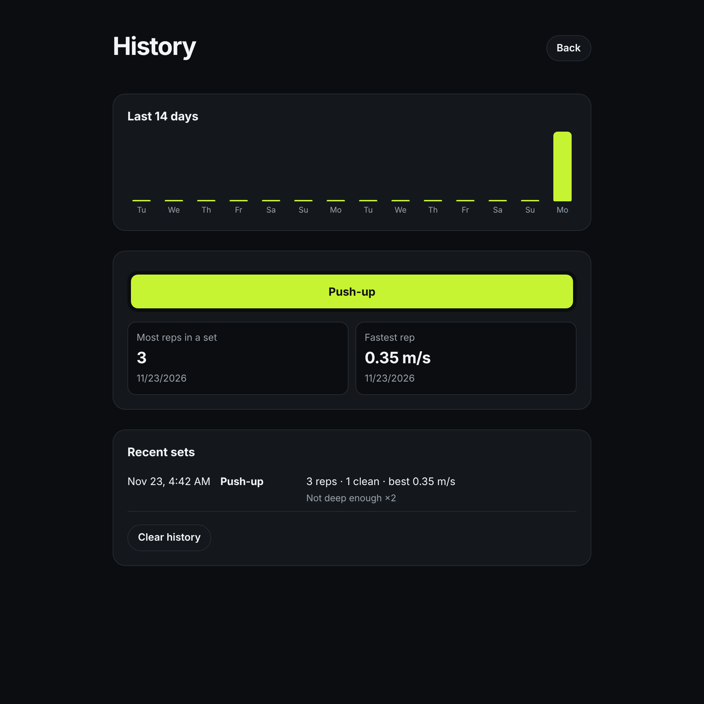

# Spotter — a real-time AI form coach that runs on your phone

**[Try it live ↗](https://spotter-gray.vercel.app)** · prop your phone up, lift, and Spotter:

- 🧠 **recognises the exercise** from your first rep: squat, push-up, deadlift, lunge, overhead press or plank
- 🔢 **counts reps** and times each one (seconds down / seconds up), or times your plank while your body stays straight
- ✅ **checks every rep**:
  - squat: depth, lockout, forward lean, and **knees caving in** (filmed from the front)
  - deadlift: **hips rising before the chest**
  - press: incomplete lockout and leaning back
  - push-up and plank: hips sagging or piking
- ⚡ **measures bar speed** in m/s from the camera alone. When speed drops 20%, it says *"Speed down 22%. About 2 left"*
- 🔊 **calls out the fix** the moment a rep ends ("Deeper", "Knees out"), or just the count when the rep is clean
- 🎬 **makes a highlight clip** of the set to share: your reps, a slow-motion freeze-frame of the rep worth a second look, and your stats
- 📈 **keeps your history** on the device: personal bests, a 14-day chart, and an **estimated 1-rep max** from your bar speed at different weights
- 🗣️ **listens for voice commands** ("end set", "next set", "mute"), so you never touch the phone with chalky hands
- 🤖 **writes an AI coach note** from the set's numbers (never the video), with an LLM on Groq (or Gemini)

Pose tracking runs **in the browser on your device** (MediaPipe on the GPU, ~30 FPS on a recent phone). The video is never uploaded.

<p align="center">
  
</p>

<p align="center">
  
  
</p>

> The screenshots use a **drawn test mannequin**, not a real person: it is how CI tests the full pipeline without footage of anyone (see [Testing](#testing)).

## How it works

```
camera frame ─► MediaPipe Pose Landmarker (GPU, WASM) ─► One Euro smoothing ─► side / front view
                                                                                   │
           Auto: recognise the exercise from the first full rep, replay buffered frames ◄──┘
                                   │
     rep state machine on the exercise's main angle: waiting → top → down → up → top
                                   │ on each finished rep
   form checks · tempo · bar path · bar speed (m/s) · speed loss · "stop" cue · reps-left estimate
                                   │
     overlay + spoken cue (same frame) · on-device recording ─► summary, highlight clip, history
```

- **Pose:** [MediaPipe Pose Landmarker](https://ai.google.dev/edge/mediapipe/solutions/vision/pose_landmarker) (BlazePose, 33 landmarks), Lite or Full model, GPU delegate with a CPU fallback. It's served by the app and cached for offline use (PWA).
- **Views:** the analyzer detects a front or side view from shoulder width against torso length. From the front, knee angles can't be read, so squat depth comes from how much the thigh shortens on screen, and the knee-to-ankle width ratio catches knees caving in.
- **Rep counting:** a state machine with hysteresis on each exercise's main angle. The press is counted from the bottom (180° − elbow), and small dips and bounces don't count as reps.
- **Bar speed:** vertical travel of the tracked point (bar, hips or shoulders) over the lifting half of each rep. Pixels are turned into metres from your height and measured leg length (thigh + shin ≈ 49% of height). Reps left = a straight-line fit of the last reps' speeds, extended down to the slowest speed a rep usually succeeds at (e.g. 0.3 m/s for squats).
- **1-rep max:** a load–velocity line through your sets at different bar weights, read off at that slowest speed.
- **Uploaded videos** are analyzed frame by frame (seek, then analyze), so no rep is skipped however slow the phone; the overlay plays along as it goes.
- **Highlight clip:** the set is recorded on-device (canvas + MediaRecorder). The clip plays the recording once from start to end, slowing down for the chosen rep and freezing at its bottom. It never seeks, because browser-made WebM files often can't seek reliably.
- **AI coach:** `api/coach.ts` is a Vercel Function. It validates the payload, keeps only known numeric fields, rate-limits each caller, and asks an LLM (Groq, or Gemini) for three short lines; if the default model has been retired it picks a current one from the provider's model list.

All analysis lives in `web/src/core/`: plain TypeScript with no browser APIs. The exact same code runs live, in unit tests, on the labelling page and in the eval.

## Measuring accuracy and training a model

- **`/label.html`:** analyze a clip frame by frame (deterministic), fix the reps and flags Spotter got wrong, and export labels with the per-frame landmarks.
- **`web/scripts/run-eval.mjs`:** re-scores every labelled clip and writes [`eval/report.md`](eval/report.md):
  - rep recall and precision, and the share of clips with the exact rep count;
  - per-flag precision, recall and F1;
  - per-frame latency.
- **[`ml/`](ml/):** turns labelled reps into angle sequences, trains a small **PyTorch** 1-D CNN with a train/test split by clip, and exports it to **ONNX** for the browser. The model only ships where it beats the rules on held-out clips.

**Status:** the tooling is built and tested end to end. The current report is a smoke test on the mannequin clip. Real-footage numbers come next.

## Run it

```bash
cd web
npm install
npm run dev        # downloads the pose models once, then serves on http://localhost:5173
```

Browsers only allow the camera on HTTPS or localhost.
- **Deploy:** import the repo into Vercel; `vercel.json` builds `web/` and `api/`.
- **AI coach note:** set `GROQ_API_KEY` (or `GEMINI_API_KEY`) in the Vercel project's environment variables; `GROQ_MODEL` / `GEMINI_MODEL` pick the model.

## Testing

```bash
cd web && npm test     # 68 unit tests
cd web && npm run e2e  # 4 Playwright tests: the real app and pose model in headless Chromium
pytest ml              # feature extraction; with PyTorch installed, also train → ONNX round trip
```

- **Unit tests** feed the analyzer synthetic skeletons with known answers:
  - every exercise, both camera views and each form flag;
  - bar speed against the true hip speed, the stop cue firing exactly once, and the reps-left fit;
  - auto-detect for every exercise, with the first rep still counted;
  - history and 1-rep-max maths, the eval metrics, voice-command parsing;
  - the AI coach endpoint's validation and rate limit.
- **Browser tests** run the full pipeline on a drawn mannequin doing 3 push-ups:
  - upload, auto-detect, highlight clip and history;
  - the fake camera;
  - the labelling page.
- **CI** runs all of it, plus PyTorch training and the ONNX export check.

**What the mannequin doesn't prove:** accuracy on real people. That's what the labelling page and the eval are for.

Spotter is a training aid, not medical advice.
